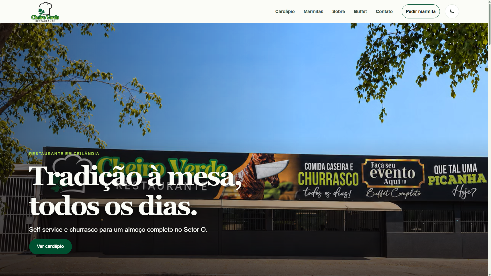
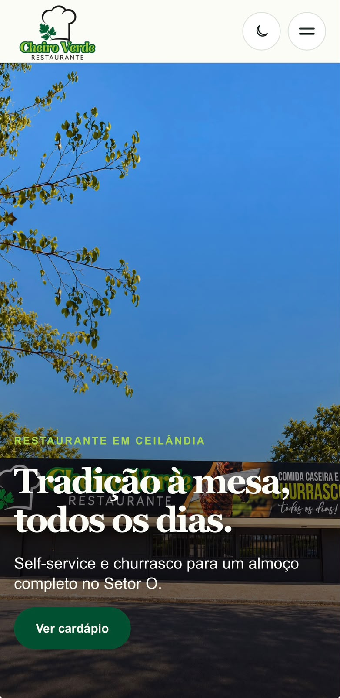

# Restaurante Cheiro Verde

## Descrição

Site institucional oficial do Restaurante Cheiro Verde, desenvolvido para apresentar a identidade visual do estabelecimento, sua história, informações comerciais, cardápio de bebidas, opções de marmitas e canais de atendimento.

A aplicação utiliza conteúdo local e páginas pré-renderizadas com o App Router do Next.js. A interface foi adaptada para diferentes tamanhos de tela, temas claro e escuro e preferências de movimento reduzido.

## Demonstração

Site oficial: [restaurantecheiroverdedf.com.br](https://restaurantecheiroverdedf.com.br)

### Desktop



### Mobile



## Funcionalidades

- Navegação responsiva entre Home, Cardápio, Marmitas, Sobre, Buffet e Contato.
- Hero com vídeos específicos para desktop e mobile, sincronizados com a posição do scroll.
- Suporte a temas claro e escuro com preferência persistida no navegador.
- Design responsivo com fotografias próprias para orientações desktop e mobile.
- Apresentação da história e das informações institucionais do restaurante.
- Cardápio de bebidas e catálogo completo de marmitas.
- Pedidos pelo WhatsApp, incluindo mensagens específicas para cada marmita.
- Exibição de endereço, horários, benefícios e canais oficiais de atendimento.
- Integração com Google Maps, Instagram, e-mail e Paladar Buffet.
- Estado global de carregamento e página 404 personalizada.
- Suporte a navegação por teclado, foco visível e `prefers-reduced-motion`.
- Manifest PWA, ícones, metadata por rota e dados estruturados do restaurante.

## Tecnologias

| Tecnologia | Uso no projeto |
| --- | --- |
| Next.js 16.4.3 | Framework, App Router, renderização e metadata |
| React 19.2.8 | Componentes e interações da interface |
| TypeScript | Tipagem da aplicação e dos dados locais |
| CSS Modules | Estilos isolados de páginas e componentes |
| CSS global | Design tokens, temas e estilos base |
| ESLint 9 | Análise estática do código |
| Node.js Test Runner | Testes automatizados de dados, helpers e estrutura |
| npm | Gerenciamento de dependências e scripts |

## Estrutura do projeto

```text
cheiro-verde-web/
├── assets/
│   └── branding/           # arquivos-fonte e exports oficiais da marca
├── docs/                   # documentação técnica do projeto
├── public/
│   └── media/
│       ├── brand/          # logos públicas e imagem social
│       ├── icons/          # favicons e ícones PWA
│       ├── menu/           # imagem do cardápio de bebidas
│       ├── photos/         # fotografias desktop, mobile e parceria Buffet
│       └── videos/         # vídeos e posters definitivos da Hero
├── src/
│   ├── app/                # páginas, layout, metadata e estilos do App Router
│   ├── components/         # componentes compartilhados e interativos
│   ├── data/               # conteúdo, contatos, links e configuração de SEO
│   └── lib/                # helpers de tema e SEO
├── next.config.mjs         # configuração do Next.js
├── package.json            # scripts e dependências
└── tsconfig.json           # configuração do TypeScript
```

Os detalhes de arquitetura e manutenção estão em [docs/project-guide.md](docs/project-guide.md). A biblioteca de mídias está documentada em [docs/media-assets.md](docs/media-assets.md).

## Autor

André Vinícius Branches Cunha
